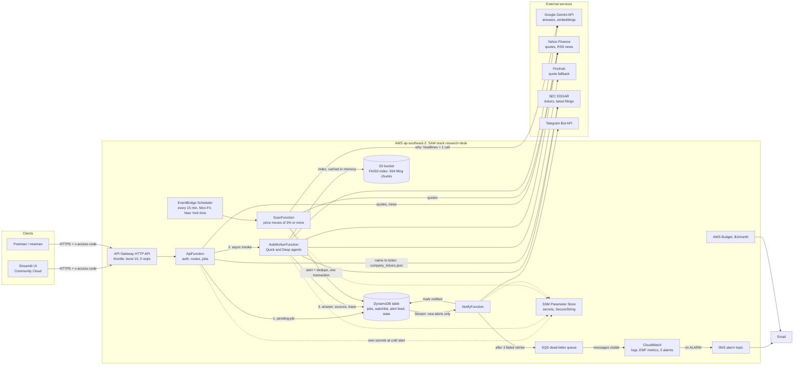

# Research Desk

An AI investment research assistant. You ask a question about a stock
("What's AMD's P/E and what's in the news?", "What risks does NVIDIA list
in its 10-K?") and get a short answer where every number and claim cites
its source: a live quote, a news headline, or a passage from an SEC filing.

It has two modes:

- **Quick:** picks the tools the question needs with keyword rules, runs them in
  parallel, and makes one Gemini call.
- **Deep:** a Gemini supervisor sends the question to specialists (market,
  news, filings) that run in parallel. They post evidence to a shared board, and a
  fact-checker checks every number in the final answer against that evidence.
  Simple questions take a fast path with one specialist.

A **Watchdog** scans the watchlist every 15 minutes during the New York
session and sends a Telegram alert, with a one-line "why", when a stock moves
3% or more.

It runs on AWS (Lambda, API Gateway, DynamoDB, S3, EventBridge Scheduler, SQS,
SNS) and is built to cost about $0/month: Gemini free tier, a small
provisioned DynamoDB table, no always-on servers.

**Try it:** the web UI is at https://research-desk-pnivvnmyzvtsqizfwgbxuz.streamlit.app/
(access code given with the submission), or use the Postman collections in
`postman/`. The design write-up is [`docs/DESIGN.md`](docs/DESIGN.md).

## Architecture



- **Ask path:** the API Lambda answers in milliseconds with `202` and a `job_id`; the worker does the slow
  work and the client polls `GET /ask/{job_id}`. Finnhub is also the fallback for the API's and the scan's
  quotes (edges left out for clarity).
- **Watchdog path:** the scan only writes alerts. Delivery is a separate function fed by the DynamoDB
  Stream, so a Telegram outage can't slow or fail the scan. Failed deliveries go to the dead-letter queue,
  and its alarm emails.
- **Operations:** all 4 functions run from one container image in ECR (its own stack, `research-desk-ecr`).
  Each reads only its own secrets from SSM. Every function logs JSON with one request ID per request.
  Five alarms email through SNS: failed alerts, API 5xx, ask errors, worker errors and scan errors.

## Results

From the deployed eval: 20 questions × 2 modes on AWS, 40/40 answered, 2026-11-09 and 11-11, scored by
code with no LLM judge ([full results](docs/eval/v2-results.md)).

| | Quick | Deep |
|---|---|---|
| Numbers not traceable to the evidence | 2 of 161 (1%) | 1 of 141 (1%) |
| Lines with numbers that carry a citation | 91% | 82% |
| Right companies found | 100% | 100% |
| Latency p50 / p90 (client-side, includes polling) | 6.5 s / 10.4 s | 13.2 s / 20.3 s |
| Gemini calls per question (mean) | 1.0 | 4.7 |

- **Cold starts:** worker init 2.6–4.3 s and API init 1.4–2.5 s across deploys; the first start of a newly
  pushed image once hit Lambda's 10 s init limit ([DESIGN](docs/DESIGN.md#known-limitations)).
- **Cost:** about $0/month is a design target, not a measured bill. It rests on the free tiers (Gemini,
  Lambda, API Gateway), a provisioned 2/2 DynamoDB table and no always-on servers. A $1 AWS Budget emails
  if that's wrong.

## How a Quick question works

1. **Request in.** `POST /ask` arrives through API Gateway at the API
   Lambda, which checks the `x-access-code` header and that the question is
   valid.
2. **Job created.** The API Lambda writes a job to DynamoDB with status
   `pending`.
3. **Worker started.** It starts the AskWorker Lambda in the background and
   immediately returns `202` with a `job_id`. It doesn't wait for the answer.
4. **Setup (cold start only).** The worker reads its API keys from SSM
   Parameter Store. Then it keeps them in memory for later requests.
5. **Tools run in parallel.**
   - Keyword routing decides which tools the question needs and which
     companies it mentions.
   - The tools are market data (yfinance, with Finnhub as a fallback), news
     (Yahoo Finance RSS, no key), and SEC filings search over a 934-chunk
     vector index loaded from S3.
   - All the tools share one deadline, so a slow tool gets cut off instead of
     holding everything up.
6. **Gemini answers.** Every tool result is labelled `[Doc N]`. One Gemini
   call writes the answer and must cite a `[Doc N]` for every number, so the
   numbers come from the tools, not the model's memory.
7. **Result saved.** The worker writes the answer, its sources and timings to
   the job and marks it `done`.
8. **Poll.** The client calls `GET /ask/{job_id}` until the status is `done`.

**Why 202 and polling instead of just waiting?** API Gateway cuts off any
request after about 30 seconds. A cold-start Quick answer took around 31 s,
and Deep mode makes many Gemini calls and takes longer still. Running the
work in the background and polling for it means a request never hits that
limit, and the API stays fast.

## Run it locally

Requires Python 3.12. On Windows, clone to a short path (e.g. `C:\rd`) or enable long paths: a dependency's
nested files (moto's) exceed 260 characters under a long path, and `pip install` then fails.

```powershell
py -3.12 -m venv .venv
.\.venv\Scripts\Activate.ps1
pip install -r requirements-dev.txt
copy .env.example .env    # then fill in your keys
python -m pytest          # unit tests, fully mocked
python cli.py --help      # local commands: quotes, news, ingest, agent, scan...
```

The keys `.env` needs:

| Key | What it's for |
|---|---|
| `GEMINI_API_KEY` | Answers and embeddings (free tier) |
| `FINNHUB_API_KEY` | Market data fallback (quotes when yfinance fails). News uses Yahoo Finance RSS and needs no key |
| `SEC_USER_AGENT` | Required by SEC EDGAR (a name and email) |
| `APP_ACCESS_CODE` | Shared secret for the API's `x-access-code` header |
| `TELEGRAM_BOT_TOKEN`, `TELEGRAM_CHAT_ID` | Watchdog alerts |

Ask a question locally (add `--deep` for the multi-agent mode):

```powershell
python cli.py agent "What is AMD's market cap and P/E ratio, and the latest headlines?"
```

## Use the deployed API

The base URL is given with the submission. Every route except `/health`
needs the header `x-access-code: <code>`.

```text
GET  /health               -> {"ok": true}
POST /ask                  -> 202 {"job_id": ..., "poll": ...}
     body: {"question": "What is AMD's P/E?", "mode": "quick"}
GET  /ask/{job_id}         -> pending ... then done, with answer + sources
```

The Postman collection in `postman/` covers every route. To use it:

1. Import `postman/Research-Desk.postman_collection.json`.
2. Create an environment with `base_url` (the API URL) and `access_code`
   (set its type to **secret**).
3. Run **Health**, then **Ask (Quick)**, then **Poll Quick answer** until
   it shows `done`.

From the command line, run the same collection with newman:
`npx newman run postman/Research-Desk.postman_collection.json --env-var base_url=... --env-var access_code=...`

`postman/Research-Desk-Demo.postman_collection.json` is the full walk-through: auth and validation errors,
market data, the watchlist, the alert feed, Quick routing and Deep mode, each step with its checks
(about 22 Gemini calls estimated; 18 in the I4 run). [`docs/example_demo.md`](docs/example_demo.md) explains every step and what proves it.

## Web UI (Streamlit)

Live at https://research-desk-pnivvnmyzvtsqizfwgbxuz.streamlit.app/. `ui/app.py` is a client of the
deployed API only. It has four tabs: **Ask** (Quick or Deep mode; the answer first, then its sources
grouped by type and a short summary of how it was made, with a "Not covered" box when a company's
filings aren't indexed), **Watchlist** (live quotes as tiles, re-read every 60 s), **Alerts** (the
Watchdog's alerts as cards, demo replays marked) and **How it works**. The warm beige/brown theme is in
`.streamlit/config.toml`; display helpers are in `ui/view.py`. It reads two Streamlit secrets, `API_URL` (the stack's `ApiUrl` output) and `ACCESS_CODE`, and viewers must
type the same access code once per session.

- **Locally:** copy `.streamlit/secrets.toml.example` to `.streamlit/secrets.toml` (git-ignored), fill in
  both values, then run `streamlit run ui/app.py` from the repo root.
- **Streamlit Community Cloud (free):** create an app from this repo with the main file `ui/app.py`; it
  installs `ui/requirements.txt`. In **Settings → Secrets**, paste the two lines from the example file
  with the real values.

## Deploy to AWS

Region `ap-southeast-2` (the only one this account can use, see D17). Needs the
AWS CLI, SAM CLI, Docker Desktop running, a filled-in `.env`, and the local
index in `data/index/index.npz`. Run from the repo root in PowerShell.

```powershell
$env:PYTHONIOENCODING = "utf-8"
$region = "ap-southeast-2"

# 1. ECR repository, its own stack (D15). Once per account.
aws cloudformation deploy --template-file infra/ecr.yaml --stack-name research-desk-ecr --region $region
$repo = aws cloudformation describe-stacks --stack-name research-desk-ecr --region $region `
  --query "Stacks[0].Outputs[?OutputKey=='ImageRepositoryUri'].OutputValue" --output text

# 2. Secrets from .env to SSM SecureStrings, BEFORE the first deploy. Each Lambda
#    container reads SSM once at cold start, so secrets must exist first.
python -m scripts.bootstrap --skip index watchlist

# 3. Build the image (one image for all functions).
sam build

# 4. Create the change set (the flags used in I1), review it, then execute it.
sam deploy --no-execute-changeset --image-repository $repo `
  --parameter-overrides EnableWatchdog=false AlertEmail=<your email>
$cs = aws cloudformation list-change-sets --stack-name research-desk --region $region `
  --query "Summaries[-1].ChangeSetId" --output text
aws cloudformation describe-change-set --change-set-name $cs --region $region `
  --query "Changes[].ResourceChange.[Action,LogicalResourceId,ResourceType]" --output table
aws cloudformation execute-change-set --change-set-name $cs --region $region
aws cloudformation wait stack-create-complete --stack-name research-desk --region $region

# 5. Upload the index (create-only) and seed the watchlist (NVDA, AMD, INTC).
python -m scripts.bootstrap --skip secrets

# 6. Smoke test.
$url = aws cloudformation describe-stacks --stack-name research-desk --region $region `
  --query "Stacks[0].Outputs[?OutputKey=='ApiUrl'].OutputValue" --output text
curl.exe $url/health        # {"ok": true}
```

With `EnableWatchdog=false` the stack has 14 resources and no price-alert
path. `EnableWatchdog=true` (the live stack) adds the scan and notify functions,
the Scheduler, the DynamoDB Stream mapping, the DLQ and the alarms: 29 resources.
Confirm the SNS subscription email that AWS sends to `AlertEmail`. The Watchdog
also needs `TELEGRAM_BOT_TOKEN` and `TELEGRAM_CHAT_ID` in SSM.

To cover another company's filings: `python cli.py ingest <TICKERS>`, then
`python -m scripts.bootstrap --replace` (swaps the S3 index, only if it is still
the version it read), then add the ticker to the watchlist.

### Teardown

Four things to remove (written from `docs/PROGRESS.md`, not run yet):

```powershell
$region = "ap-southeast-2"
function Empty-Bucket($name) {   # removes all object versions, so versioned buckets empty too
  python -c "import boto3,sys; boto3.resource('s3', region_name='$region').Bucket(sys.argv[1]).object_versions.delete()" $name
}

# 1. The main stack. Its DataBucket is Retain, so it outlives the stack.
$bucket = aws cloudformation describe-stacks --stack-name research-desk --region $region `
  --query "Stacks[0].Outputs[?OutputKey=='DataBucketName'].OutputValue" --output text
sam delete --stack-name research-desk --region $region
Empty-Bucket $bucket; aws s3 rb "s3://$bucket" --region $region

# 2. The ECR stack. CloudFormation can't delete a repository that still has images.
aws ecr delete-repository --repository-name research-desk --force --region $region
aws cloudformation delete-stack --stack-name research-desk-ecr --region $region

# 3. SAM's own stack and bucket (created by resolve_s3 = true in samconfig.toml).
$samBucket = aws cloudformation describe-stack-resources --stack-name aws-sam-cli-managed-default --region $region `
  --query "StackResources[?ResourceType=='AWS::S3::Bucket'].PhysicalResourceId" --output text
Empty-Bucket $samBucket
aws cloudformation delete-stack --stack-name aws-sam-cli-managed-default --region $region
aws cloudformation wait stack-delete-complete --stack-name aws-sam-cli-managed-default --region $region
aws s3 rb "s3://$samBucket" --region $region   # only if the stack kept it

# 4. The secrets.
aws ssm delete-parameters --region $region --names /research-desk/GEMINI_API_KEY `
  /research-desk/FINNHUB_API_KEY /research-desk/TELEGRAM_BOT_TOKEN /research-desk/TELEGRAM_CHAT_ID `
  /research-desk/SEC_USER_AGENT /research-desk/APP_ACCESS_CODE
```

## Docs

- [`docs/DESIGN.md`](docs/DESIGN.md): design choices, known limitations,
  production improvements (the brief's 1–2 page document)
- [`docs/DEMO-SCRIPT.md`](docs/DEMO-SCRIPT.md): the interview run sheet
  (15 + 20 + 15 min)
- [`docs/example_demo.md`](docs/example_demo.md): every deployed feature,
  step by step, with what proves it
- [`docs/eval/v2-results.md`](docs/eval/v2-results.md): the eval, local and
  deployed
- [`docs/SPEC.md`](docs/SPEC.md): features, architecture, API, agents
- [`docs/DECISIONS.md`](docs/DECISIONS.md): trade-offs, including why Gemini
  instead of Bedrock
- [`docs/PROGRESS.md`](docs/PROGRESS.md): build log, every deploy and
  measurement
- [`docs/ITERATIONS.md`](docs/ITERATIONS.md): delivery plan (I0–I5)
- [`docs/ASSESSMENT.md`](docs/ASSESSMENT.md): the original brief
- [`AGENT.md`](AGENT.md): Builder and Reviewer prompts

`evals/questions.json` is the 20-question eval set. v1 lives at
`../investment-research-assistant` as a read-only reference.

## Repo map

| Path | What it is | Used in |
|---|---|---|
| `core/` | Agents, tools, LLM client, SEC ingest, vectors, store, market data, news, alerts | all |
| `aws_lambda/` | Lambda handlers: `api`, `ask_worker` (ask path); `scan`, `notify` (Watchdog) | I1–I3 |
| `jobs/` | Price-move scan logic, shared by `cli.py scan` and the scan Lambda | I3 |
| `ui/` | Streamlit frontend: `app.py` and its API client `client.py` (HTTP only, own `requirements.txt`) | I4 |
| `cli.py` | Local CLI: `quotes`, `market`, `news`, `resolve`, `ingest`, `retriever`, `agent`, `scan` | I0–I5 |
| `scripts/` | `bootstrap.py`: SSM secrets, create-only index upload, watchlist seed | I1, I3 |
| `infra/` | `ecr.yaml`: the ECR repository stack, deployed before `sam deploy` (D15) | I1 |
| `template.yaml`, `samconfig.toml`, `Dockerfile` | SAM stack and the Lambda image (Region in `samconfig.toml`, D17) | I1–I4 |
| `postman/` | Postman collections: every API route, and the demo walk-through (run with `newman`) | I1–I5 |
| `evals/` | 20-question eval set, runner and frozen scorer | I2, I4 |
| `tests/` | Unit tests (fully mocked; `python -m pytest`) | all |
| `.github/` | CI: pytest on every push | all |
| `docs/` | Spec, decisions, iterations, progress, eval results, reviews; `archive/` holds old plans | all |
| `data/` (git-ignored) | Local FAISS index (`index/`) and embedding cache (`cache/`) | I1 upload, local runs |
| `.cache/` (git-ignored) | SEC ticker map and the local SQLite store | local runs |