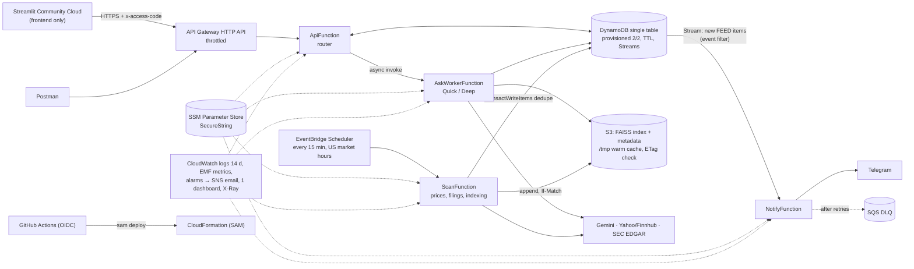

# SPEC — Research Desk (v2, clean rebuild)

> The single description of what to build. Written 2026-11-04 from the first version
> (`../investment-research-assistant`, read-only reference), which worked locally but grew through
> five plan changes. v2 builds the **final** design directly. Brief: [`ASSESSMENT.md`](ASSESSMENT.md).
> Deviations from the brief and other trade-offs: [`DECISIONS.md`](DECISIONS.md).

---

## 1. What it is

An AI investment research assistant for one user. Ask it a research question about any US stock and it
answers in under a minute, from live prices, news and SEC filings, citing every source. It also watches a
watchlist and messages your phone (Telegram) when a stock moves hard or files with the SEC, saying *why*.

**60-second pitch:** *"An API on AWS Lambda answers research questions with a team of Gemini agents: a
supervisor sends market, news and filings specialists out in parallel, and a fact-checker verifies every
number against the evidence. Every 15 minutes an EventBridge schedule scans the watchlist; alerts are written
to DynamoDB exactly once and a DynamoDB Stream pushes them to Telegram. It all runs at about $0/month,
defined in AWS SAM and deployed by GitHub Actions."*

---

## 2. Features (must-have)

| # | Feature | Acceptance (demoable) |
|---|---|---|
| F1 | **Market data tool**: quote for any US ticker (price, prev close, day %, volume, market cap, P/E). yfinance primary, **Finnhub fallback** on error/block/empty. Each quote carries `source`. | Quote for NVDA with yfinance mocked to fail comes from Finnhub; QQQ and SPY quotes work on the free Finnhub key. |
| F2 | **News tool**: Yahoo Finance RSS per ticker, kept only if the headline names the ticker/company; fall back to top stories. | `cli news NVDA` returns dated, linked headlines. |
| F3 | **Ticker resolution**: "advanced micro devices", "Apple", `MSFT` → ticker + CIK via SEC `company_tickers.json` (cached). | Unknown names give a friendly "not found". |
| F4 | **Knowledge base (RAG)**: FAISS over SEC filings (10-K, 10-Q, earnings 8-K) for NVDA, AMD, INTC at start (3–5 companies). Gemini `gemini-embedding-001`, 768 dims, L2-normalised; ~300-token chunks, 50 overlap; metadata `ticker, form, filed, url, section`. Balanced retrieval: over-fetch 50, keep ≤3 chunks per company. | "Compare NVIDIA and AMD data center revenue" retrieves chunks from both. The brief's example query (GPU customers' revenue) needs **10-K customer-concentration** sections — index 10-Ks, not only press releases. |
| F5 | **Quick mode**: keyword routing → tools in parallel → one Gemini answer with citations. ~5 s p50. | Answers cite `[source]` for every number. |
| F6 | **Deep mode (agentic)**: supervisor plans (JSON) → Market, News, Filings specialists run **in parallel**, each a Gemini function-calling loop over its own tools → shared **evidence board** (E1, E2…) → one follow-up round if gaps → supervisor writes citing `[E#]` → **fact-checker**. | The brief's NVIDIA/AMD/Intel query is answered with all three specialists and citations. |
| F7 | **Fact-checker**: code matches every number in the answer to evidence (units, "(in millions)", rounding); only unmatched numbers go to one LLM call ("derived" vs "unsupported"); unsupported → marked ⚠️unverified. | A planted fake number is flagged; derived growth % is accepted. |
| F8 | **Price alerts**: per ticker `pct_move` (default ±3%), optional `price_above` / `price_below`. Once per rule per day. | Replaying a −7.5% move creates exactly one alert even if the scan runs twice. |
| F9 | **"Why did it move"** on each price alert, cheapest-and-certain first: (1) code: if QQQ or SPY moved ≥1.5% the same way and the stock ≤1.5× that → "moved with the market"; (2) code: headlines from the **session window** (previous close → this close, 4 pm New York) naming the company; (3) LLM may only *pick* one of those headlines; else "no clear catalyst found". Never guesses. | An after-hours headline explains the *next* session, not this one (a real bug in v1). |
| F10 | **SEC filing alerts + earnings snapshot**: new 10-K/10-Q/8-K from `data.sec.gov/submissions/CIK##########.json`; for 10-Q/10-K, revenue, diluted EPS, net income vs last quarter and last year from XBRL `companyfacts` (**code does the math**). Earnings 8-K press releases aren't XBRL-tagged: LLM extracts current figures, kept only if the number appears verbatim in the quoted line; comparison quarters from XBRL. Other 8-Ks: 3-sentence summary. | NVDA's latest 10-Q produces a snapshot whose numbers match EDGAR. |
| F11 | **Knowledge base follows the watchlist**: adding a ticker queues its latest 10-K, 10-Q and earnings 8-K for indexing; new filings are indexed by the scan. Daily embedding cap `FILING_EMBED_DAILY_CAP=400` (Gemini embed free tier ≈1,000 requests/day); overflow continues next run. | Add MSFT → next scan indexes its filings; Deep mode answers a filing question about it. |
| F12 | **Telegram delivery** of alerts via DynamoDB Stream → notifier Lambda; failures after retries → SQS DLQ + alarm. | Alert reaches the phone; a forced Telegram failure lands in the DLQ and fires the alarm. |
| F13 | **API** (API Gateway HTTP API → Lambda) + **Streamlit** frontend (Community Cloud, calls the API only) + **Postman collection**. | All routes in §5 work from Postman against the deployed URL. |
| F14 | **Eval harness**: 20 questions (`evals/questions.json`, reuse v1's), both modes, metrics computed by code (§9). | `python -m evals.run` writes `docs/EVAL.md`. |

**Not in scope:** weekly email digest, Supabase/pgvector/GitHub-cron alternative backend, user accounts,
portfolio tracking, insider (Form 4) parsing, guidance/risk-factor diffs, Bedrock.

---

## 3. Architecture



| Need | Service | Why |
|---|---|---|
| Compute | Lambda, **one container image** (ECR), 4 functions | numpy/pandas/faiss/genai exceed the 250 MB zip limit |
| API | API Gateway **HTTP API** (not REST), stage throttling | cheaper; throttling protects free quotas |
| Long answers | `POST /ask` → 202 + job id; worker Lambda; `GET /ask/{id}` | API Gateway's 30 s limit < Deep mode's 20–75 s |
| Schedule | EventBridge Scheduler, cron every 15 min Mon–Fri 9:30–16:00 New York | on time, no servers |
| Data | DynamoDB single table, **PROVISIONED 2/2** (always free; on-demand isn't), TTL, Streams | atomic dedupe via transactions |
| Vectors | FAISS on S3 (~5–10 MB), `/tmp` cache re-checked by ETag; writes use S3 conditional writes (`If-Match`) and retry on conflict | no OpenSearch cost |
| Secrets | SSM Parameter Store SecureString, read once per cold start | free; Secrets Manager isn't |
| Images | **own `AWS::ECR::Repository`** in the template with a lifecycle policy keeping 2 images | SAM's auto-created repo can't take a lifecycle policy |
| Observability | CloudWatch logs (14 d), EMF metrics, alarms → SNS email, 1 dashboard, X-Ray | free-tier |
| Cost guard | `AWS::Budgets::Budget` $1 → email | proves ~$0 |
| Deploy | AWS SAM + GitHub Actions with **OIDC** role (no stored keys) | IaC + secure CI |

Region `ap-south-1`. Never: NAT gateway, VPC for Lambda, provisioned concurrency, Secrets Manager,
CloudFront, OpenSearch, RDS, Bedrock.

---

## 4. DynamoDB single-table design (`ResearchDesk`)

| pk | sk | Item | Notes |
|---|---|---|---|
| `WATCH` | `TICKER#NVDA` | watchlist row + alert rules (`pct_move`, `price_above`, `price_below`) | `Query pk=WATCH` |
| `FEED` | `<created_at>#<id>` | alert / filing event | `Query pk=FEED, ScanIndexForward=false, Limit=20`; TTL 30 d; **Stream source** |
| `SEEN#<dedupe_key>` | `-` | dedupe marker | written in the **same transaction** as the FEED item with `attribute_not_exists(pk)`; TTL 90 d |
| `STATE` | `<key>` | job state: last seen filing per CIK, index queue, embed/Deep daily counters | |
| `JOB` | `<job_id>` | async ask job: status, result | TTL 1 d |

Dedupe keys: `AMD:move_down:2026-11-02`, `NVDA:price_above:2026-11-02`, `sec:<accession>`.
Filing summaries/snapshots are computed **before** the FEED insert so the Stream sees complete events.

---

## 5. API contract

All routes except `/health` require header `x-access-code` (value in SSM). The API refuses everything if
the code isn't configured. JSON errors: `{"error": "<safe message>"}`, never stack traces.

| Method | Path | Body / response |
|---|---|---|
| GET | `/health` | `{"ok": true}` |
| GET | `/watchlist` | rows with rules |
| POST | `/watchlist` | `{"ticker" or "name", "pct_move"?, "price_above"?, "price_below"?}` → resolved row; queues filings for indexing |
| DELETE | `/watchlist/{ticker}` | |
| GET | `/quotes` | quotes for the watchlist (one batched call), each with `source` |
| GET | `/news/{ticker}` | headlines |
| GET | `/feed` | latest 20 alerts/filings |
| POST | `/ask` | `{"question", "mode": "quick" \| "deep"}` → `202 {"job_id", "poll"}` |
| GET | `/ask/{job_id}` | `{"status": "pending" \| "done" \| "error", "answer", "sources", "trace", "timings"}` |

Ticker path params: `^[A-Za-z.\-]{1,10}$`. Question length capped (e.g. 1,000 chars).

---

## 6. Agents (Deep mode) — contracts and budgets

| Agent | Tools (Gemini function calling) | Output |
|---|---|---|
| Supervisor | `resolve_company` | `Plan` JSON (companies, tasks per specialist), then final answer citing `[E#]` |
| Market Analyst | `get_quote`, `get_quotes` | `Report` |
| News Analyst | `get_news`, `recent_alerts` | `Report` |
| Filings Analyst | `search_filings`, `latest_filing` | `Report` |
| Fact-Checker | `verify_numbers` (code) + ≤1 LLM call | verdict + corrected answer |

- Manual function-calling loop (automatic calling off) so every step is traced and limited.
- ≤3 tool steps per specialist; tools within a step run in parallel; ≤1 follow-up round.
- Fast path: a simple lookup goes to one specialist.
- **75 s total budget**; each Gemini attempt's timeout shrinks to the time left; after it, answer with what's on the board, marked partial.
- Any failure → fall back to Quick, so the user always gets an answer. `DEEP_MODE_DAILY_CAP` guards the free tier.
- Response includes the trace ("How I answered") for the UI.

**LLM layer** (`core/llm.py`): one provider interface; Gemini free tier only. Chain:
`gemini-3.5-flash-lite → gemini-3.1-flash-lite → gemini-flash-lite-latest → gemini-3.5-flash`
(verify names on day 1: `gemini-2.5-flash-lite` already returns 404 for new keys). Move on after 429/5xx/timeout;
per-call timeout 30 s, total budget 45 s (Quick); a model that fails with 5xx/timeout is skipped for 60 s.
Raise `LLMUnavailableError` → friendly message.

---

## 7. Cross-cutting rules

- **Numbers come from tools/SEC data or code, never from the LLM's memory.** The LLM picks, phrases and extracts; code computes and checks.
- **Every answer cites its sources** (URL or filing + section, quote source and timestamp).
- **Error handling:** every external call has a timeout; retries with backoff only where safe; one failed tool returns a partial answer that says what failed.
- **Logging:** structured JSON, a request ID carried from API → worker → agents → tools; log tool name, latency, success, token usage. Never log secrets.
- **Metrics (EMF, namespace `ResearchDesk`):** `AgentLatency` (dim `Mode`), `GeminiCalls`, `DeepFallbacks`, `AskErrors`, `ScanSeconds`, `PriceEvents`, `FilingEvents`, `ChunksEmbedded`, `AlertsSent`, `AlertSendFailures`, `QuoteFallbacks` (Finnhub used).
- **Alarms:** DLQ depth > 0, scan errors, Deep p90 latency, API 5xx.
- **Security:** least-privilege IAM per function; SSM read scoped to `/research-desk/*`; S3 public access blocked + SSE; input validation on every route.
- **Local dev without AWS:** `STORE_BACKEND=local` (SQLite) and `VECTOR_BACKEND=local` (FAISS files), so the app, CLI and tests run on a laptop with only a Gemini key.
- **Code layout:** all logic in `core/` as plain functions; `aws_lambda/`, `jobs/`, `app.py`, `cli.py` only call it.

---

## 8. Target repo layout

```
app.py                  Streamlit frontend (API client only; Quick/Deep toggle, trace expander)
cli.py                  market | news | resolve | retriever | agent [--deep] | scan [--dry-run]
core/
  config.py llm.py embeddings.py
  market.py (yfinance + finnhub) news.py tickers.py sec.py xbrl.py
  retriever.py vectors.py (s3 | local) ingest.py (filing → chunks → embeddings)
  agent.py              Quick mode
  agents/               supervisor, specialists, loop, tools, evidence, checker
  alerts.py explain.py filings.py telegram.py
  store.py (local SQLite) store_dynamo.py
  logging.py            JSON logs + request id
aws_lambda/             runtime.py (SSM, EMF), api.py, ask_worker.py, scan.py, notify.py
jobs/scan.py            the scan, runnable locally
scripts/bootstrap.py    SSM secrets + initial index upload + seed watchlist
evals/                  questions.json, run.py → docs/EVAL.md
tests/unit/             mocks + moto only
postman/                Research-Desk.postman_collection.json
template.yaml  Dockerfile  samconfig.toml
.github/workflows/      ci.yml (pytest), deploy.yml (OIDC → sam build/deploy on main)
docs/                   ASSESSMENT, SPEC, DECISIONS, PLAN, PROGRESS, reviews/, AWS_SETUP, DESIGN (1–2 pages), EVAL
```

---

## 9. Testing and evaluation

- Unit tests with mocks/moto only (no network, no secrets); CI runs them on every push.
- Must cover failure paths: unknown ticker, market closed, empty news, Yahoo blocked → Finnhub, 429, LLM timeout, malformed LLM JSON, duplicate scan, Telegram failure.
- Eval (code-computed, no LLM judge), Quick vs Deep on the same live data:
  - numbers not traceable to evidence (lower is better)
  - right companies found; right tools/agents used
  - lines with numbers that carry a citation
  - latency p50/p90; Gemini calls per question; fallbacks
- v1 baseline to beat or match: routing 75% → 95%, cited lines 51% → 90%, untraceable numbers 1/109 → 0/98, latency p50 4.7 s (Quick) / 23.4 s (Deep).

---

## 10. Gotchas learned in v1 (save a day)

| Gotcha | Fix |
|---|---|
| `gemini-2.5-flash-lite` → 404 for new keys | default to `gemini-3.5-flash-lite`; check model names on day 1 |
| Gemini calls took 7–40 s under load; the SDK can hang for minutes | per-call HTTP timeout + total budget + model cooldown |
| Gemini free tier: embeddings ~1,000 requests/day (each text in a batch counts), 30k tokens/min | daily embed cap, batch by tokens, log usage |
| Mixing embedding models (old `text-embedding-004` index + new query model) silently breaks retrieval | one embedding service for both sides; rebuild the index if the model changes |
| SEC returns 403 without a `User-Agent` containing a contact email; max 10 req/s | `SEC_USER_AGENT` env var; global throttle |
| Yahoo often blocks/rate-limits AWS IPs | Finnhub fallback; record `source` |
| Finnhub free tier has **no historical candles**; Alpha Vantage free ≈25 requests/day (too few) | use Finnhub only for current quotes (day % change is in the quote) |
| Lambda zip limit 250 MB | one container image; Docker Desktop running for `sam build` |
| API Gateway 30 s integration limit | async job pattern for `/ask` |
| DynamoDB on-demand is not in the always-free tier | PROVISIONED 2/2 |
| An after-hours headline explains the next session | session window in New York time |
| Earnings 8-K press releases aren't XBRL-tagged | extract with LLM, keep only verbatim-quoted numbers |
| "Compare A and B" retrieval returned only A | over-fetch + per-company cap |
| Windows: Unicode output crashes scripts | `$env:PYTHONIOENCODING="utf-8"` |
| Windows: `sam` may not be on PATH | `C:\Program Files\Amazon\AWSSAMCLI\bin\sam.cmd` |
| New AWS accounts start on a credit-based Free plan (6 months) | the always-free allowances used here continue on the Paid plan; keep the $1 budget |
| Several agent sessions editing one repo at once | one session at a time |

---

## 11. Deliverables checklist (from the brief)

- [ ] Repo with source, `template.yaml`, README with setup steps
- [ ] Architecture diagram as an image (export from §3) in README
- [ ] Working deployed demo of 3+ queries (demo script in `docs/PLAN.md`)
- [ ] `docs/DESIGN.md`: 1–2 pages — design choices, challenges, production improvements
- [ ] Postman collection + Streamlit URL

## 12. Resume claims (fill only with measured numbers)

Tech line: Python, AWS Lambda, API Gateway, DynamoDB, EventBridge, S3, SQS, CloudWatch, X-Ray, AWS SAM,
Docker/ECR, Gemini, FAISS, GitHub Actions.
To measure on the deployed stack: Deep/Quick p50 and p90, alert latency (scan → Telegram), cold start,
`/tmp` index cache hit rate, cost/month after 48 h, eval scores.
