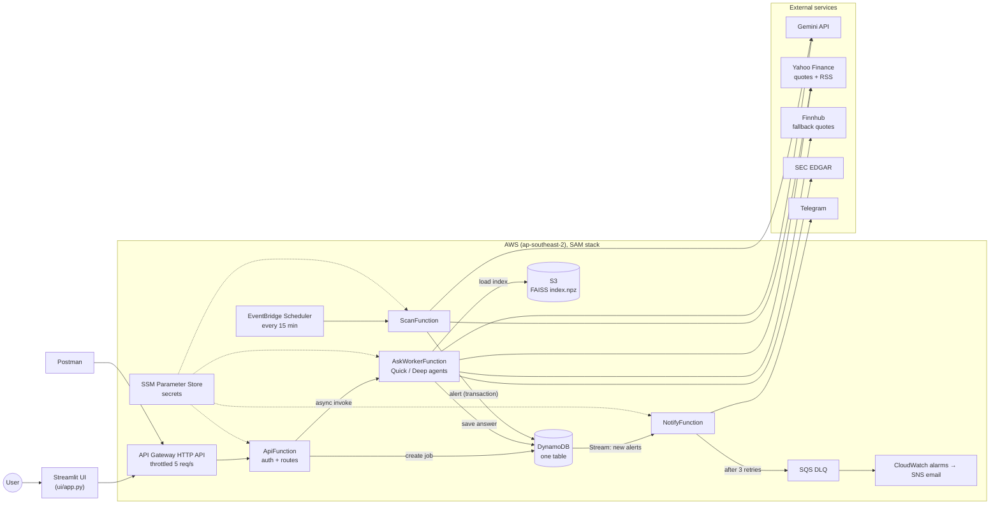

# 03 · System Design

## Architecture diagram

## What each component does

- **Streamlit UI** (`ui/app.py`, `ui/client.py`): the web page. It asks for the access code once, sends questions, polls for answers every 2 s (up to 150 s), and shows sources and quote tiles. It only speaks HTTP to the API.
- **API Gateway HTTP API**: the public HTTPS front door. It throttles to a burst of 10 and 5 requests/s, which protects the free API quotas. It sends every path to `ApiFunction`.
- **ApiFunction** (`aws_lambda/api.py`): checks the access code, validates input, and runs fast routes (watchlist, quotes, news, feed). For `/ask` it creates a job and starts the worker. It never waits for the answer. Timeout 29 s.
- **AskWorkerFunction** (`aws_lambda/ask_worker.py`): does the slow AI work. It runs Quick (`core/agent.py`) or Deep (`core/agents/deep.py`), saves the result on the job item, and records metrics. Timeout 120 s, retries 0.
- **DynamoDB table**: one table holds 5 item types (watchlist, alert feed, dedupe markers, state, jobs). Details are in 04.
- **S3 bucket**: holds the FAISS index as one `vectors/index.npz` file. Each worker container downloads it once, keeps it in memory, and rechecks the ETag (the file's version tag) every 5 minutes.
- **SSM Parameter Store**: the encrypted secrets. Each function reads only its own list (`SSM_SECRETS`) at cold start (`aws_lambda/runtime.py` `bootstrap()`).
- **EventBridge Scheduler → ScanFunction** (`aws_lambda/scan.py`, `jobs/scan.py`): every 15 min in New York market hours. It fetches quotes, applies the alert rules, explains moves, and *writes* alerts. It doesn't send them.
- **NotifyFunction** (`aws_lambda/notify.py`): DynamoDB Streams wakes it for each new alert. It sends the alert to Telegram and marks it `notified`. Failures are retried 3 times, then go to the SQS dead-letter queue (DLQ). A DLQ is a holding queue for messages that kept failing.
- **CloudWatch + SNS**: JSON logs with one request ID per request, plus 5 alarms (failed alerts, API 5xx, ask errors, worker errors, scan errors) that email via SNS.

> **Cold start:** the first request to a new Lambda container must load code and secrets first. Here that takes 2.6–4.3 s for the worker.

## Request flow: a user asks a Quick question

1. The user types a question in the Ask tab. `DeskClient` in `ui/client.py` sends `POST /ask` with `{"question": "...", "mode": "quick"}` and the `x-access-code` header.
2. API Gateway forwards the request to `ApiFunction` → `handler()` → `_route()`.
3. `_route()` checks the code with `_authorized()`. It uses `hmac.compare_digest`, a constant-time compare, so timing can't leak the code. Wrong code → `401`.
4. `post_ask()` validates the input: the question is present and ≤1000 characters, `mode` is quick or deep, and `include_context` is a boolean. Bad input → `400`.
5. `store.create_job()` writes `{pk: "JOB", sk: <job_id>, status: "pending"}` to DynamoDB, with a 1-day TTL. TTL (time to live) means DynamoDB deletes the item automatically after that.
6. `_invoke_worker()` starts `AskWorkerFunction` with `InvocationType="Event"` (fire and forget). The API returns **`202 {"job_id", "poll": "/ask/<id>"}`** in milliseconds.
7. The worker's `handler()` calls `agent.answer(question)`:
   - `classify_query()` picks tools with whole-word regexes (`MARKET_PATTERN`, `NEWS_PATTERN`, `RAG_PATTERN`).
   - `tickers.find_companies()` finds up to 3 companies.
   - The tools run in a thread pool with one shared 25 s deadline (`TOOL_TIMEOUT_SECONDS`).
   - Every result is labelled `[Doc N]`, and `llm.generate()` makes one Gemini call that must cite `[Doc N]` for every number.
8. The worker calls `store.finish_job(job_id, "done", compact(result))` and emits metrics with `emit_metrics()`.
9. Meanwhile the UI polls `GET /ask/{job_id}` every 2 s. `get_ask()` returns `pending` until the status is `done`. Then the UI shows the answer and its sources.

## Folder structure

| Path | What lives there |
|---|---|
| `core/` | The real logic: `agent.py` (Quick), `llm.py` (Gemini + fallback), `market.py`, `news.py`, `tickers.py`, `sec.py`, `ingest.py` (build the index), `embeddings.py`, `vectors.py`, `retriever.py`, `store.py` / `store_dynamo.py`, `alerts.py`, `explain.py`, `telegram.py`, `numbers.py`, `log.py`, `config.py` |
| `core/agents/` | Deep mode: `deep.py` (orchestrator), `supervisor.py`, `specialists.py`, `loop.py` (function-calling loop), `tools.py`, `evidence.py`, `checker.py` |
| `aws_lambda/` | Thin Lambda handlers: `api.py`, `ask_worker.py`, `scan.py`, `notify.py`, plus `runtime.py` (cold-start setup, metrics) |
| `jobs/` | `scan.py`: the price scan, shared by the CLI and the scan Lambda |
| `ui/` | Streamlit app (`app.py`), API client (`client.py`), display helpers (`view.py`) |
| `evals/` | `questions.json` (20 questions), `run.py` (runner), `scoring.py` (frozen scorer) |
| `scripts/` | `bootstrap.py`: secrets → SSM, index → S3, seed the watchlist |
| `infra/` | `ecr.yaml`: the ECR repository stack |
| `tests/unit/` | 442 mocked tests (`moto` for AWS) |
| `cli.py` | Local commands: `market`, `quotes`, `news`, `resolve`, `ingest`, `retriever`, `agent`, `scan` |
| `template.yaml` | The SAM stack: every AWS resource |
| `docs/` | Spec, decisions, design, progress log, eval results, reviews |

The key design pattern: **`core/` knows nothing about AWS handlers.** Backends are switched by environment variables (`STORE_BACKEND=local|dynamodb`, `VECTOR_BACKEND=local|s3`), so the same code runs on a laptop with SQLite and FAISS files, and on Lambda with DynamoDB and S3.

## How it's deployed and runs

- **Region:** `ap-southeast-2` (Sydney), the only Region the AWS account allowed (D17).
- **Steps** (README "Deploy to AWS"):
  1. Deploy the ECR stack (`infra/ecr.yaml`).
  2. `python -m scripts.bootstrap --skip index watchlist` puts the secrets in SSM.
  3. `sam build` builds the one Docker image.
  4. `sam deploy` creates a change set; review it, then execute it.
  5. `bootstrap --skip secrets` uploads the index and seeds the watchlist.
  6. Run `curl /health`.
- **Feature flag:** `EnableWatchdog=false` gives 14 resources (ask path only). `true` gives 29 (adds scan, notify, Scheduler, Stream, DLQ, alarms).
- **CI:** GitHub Actions runs `pytest` on every push. Deploys are manual `sam deploy`. An OIDC deploy workflow was cut for time (D13).
- **UI:** Streamlit Community Cloud, main file `ui/app.py`, secrets `API_URL` and `ACCESS_CODE`.
